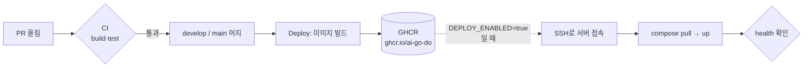
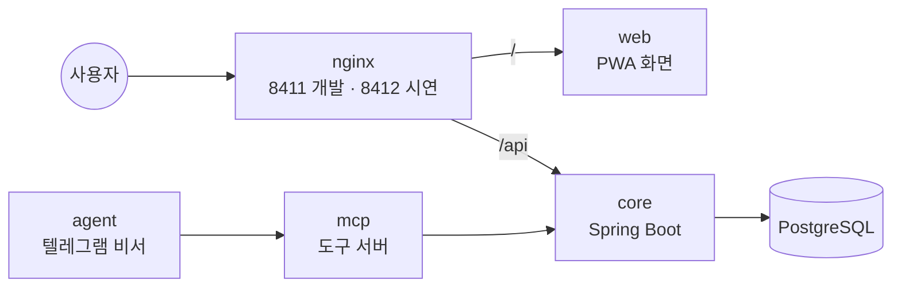

# infra

M-SPACE 서버 실행 설정 (담당: 재웅). 앱 코드는 각 저장소(mspace-core, mspace-web …)에 있고, 여기는 **서버에서 어떻게 띄우는지**만 둔다.

| 파일 | 하는 일 |
|---|---|
| `compose.yaml` | 입구 nginx → 화면(web)·core → PostgreSQL, AI 비서(mcp·agent)는 안쪽에서만. 밖으로 열리는 포트는 nginx 하나 |
| `nginx/default.conf` | `/api` → core, 나머지 → 화면(web) |
| `scripts/backup.sh` | DB를 `backups/dev/`·`backups/prod/`에 날짜별로 백업, 7일 지난 건 삭제. 서버 cron으로 매일 실행 |
| `.env.example` | 환경별 값 목록 (값은 비움). 실제 값은 `.env.dev` / `.env.prod`, 커밋 금지 |

## 전체 흐름

코드가 서버에 올라가기까지. 팀원은 PR만 올리면 되고, 나머지는 자동으로 돈다.



| 언제 | 무엇이 | 결과 |
|---|---|---|
| PR 올릴 때 | `ci.yml` (빌드·테스트, 레포마다 Sonar) | 실패하면 머지 버튼 막힘 |
| develop·main에 머지될 때 | `deploy.yml`의 `image` job | 이미지 태그 `develop`/`main` + `sha-xxxxxxx` |
| 그 다음 (서버 준비 후 켬) | `deploy.yml`의 `server` job | develop → 개발 서버(8411), main → 시연 서버(8412) |

서버 안에서는 이렇게 연결된다. 밖에서 들어오는 문은 nginx 하나뿐이다.



## 띄우기

```bash
cp .env.example .env.dev        # DB_PASSWORD 채우기
openssl rand -hex 32            # 장치 토큰. 개발·시연용을 따로 만들어 .env.dev / .env.prod의 MSPACE_DEVICE_TOKEN에 넣는다. 비어 있으면 compose가 멈춘다
# 같은 값을 그 서버를 부르는 키패드(게이트웨이) 장치의 .env에도 넣는다. 다르면 장치 요청이 401
openssl rand -base64 48         # 로그인 토큰 서명값. 개발·시연용을 따로 만들어 JWT_SECRET에 넣는다. 비어 있으면 compose가 멈춘다
# 이미 .env.dev/.env.prod가 있으면 WEB_TAG 줄을 추가 (개발 develop, 시연 main). 없으면 compose가 멈추고 알려 준다
docker compose -p mspace-dev  --env-file .env.dev  up -d    # 개발 (8411, develop 이미지)
docker compose -p mspace-prod --env-file .env.prod up -d    # 시연 (8412, main 이미지)
curl localhost:8411/actuator/health
```

화면 이미지(`mspace-web`)는 mspace-web 레포의 `deploy.yml`이 develop·main에 머지될 때 GHCR에 올린다. 아직 그 태그가 GHCR에 없으면 `up`이 web을 받지 못해 멈추니, 그동안은 같은 이름으로 직접 빌드해 쓴다(compose는 로컬에 있는 이미지를 먼저 쓴다).

```bash
docker build -t ghcr.io/ai-go-do/mspace-web:develop ../mspace-web   # mspace-web 클론 위치
```

## 입구 nginx 포트와 설정 반영

- gateway는 `127.0.0.1:${PORT}`(서버 안)에서만 받는다. 학교 nginx가 같은 서버에서 `proxy_pass http://127.0.0.1:<포트>`로 부르므로 정상 길은 그대로이고, 밖에서 `http://s2.java21.net:<포트>`로 HTTPS 없이 바로 들어오는 길은 막힌다. 서버에서 `ss -tlnp | grep 8411`이 `127.0.0.1:8411`로 나오면 맞다.
- 맥에서 같은 와이파이의 폰·키패드 노트북으로 시험할 때만 `.env.dev`에 `BIND_ADDR=0.0.0.0`. 서버에서는 넣지 않는다.
- `nginx/` 폴더를 통째로 연결한다. 각 레포 배포(server job)가 끝에 일회용 컨테이너로 `nginx -t` → `gateway` `up` → `nginx -s reload` 하므로, `nginx/default.conf`를 고쳐 main에 머지하면 다음 배포 때 반영된다. 바로 반영하려면 서버에서:

```bash
T=dev   # 시연 서버는 T=prod
C="docker compose -p mspace-$T --env-file .env.$T"
# 일회용 컨테이너로 먼저 문법 확인(포트 안 엶) → 통과하면 gateway 갱신 → 다시 읽기
git pull --ff-only && $C run --rm --no-deps -T gateway nginx -t && $C up -d --no-deps gateway && $C exec -T gateway nginx -s reload
```

## 되돌리기

`.env.*`의 `CORE_TAG`(화면은 `WEB_TAG`, 비서는 `ASSISTANT_TAG`)를 이전 이미지(`sha-xxxxxxx`)로 바꾸고 `docker compose ... up -d`.

## 백업

```bash
scripts/backup.sh prod                     # 지금 바로 한 번
crontab -e                                 # 매일 새벽 4시 자동
0 4 * * * cd ~/infra && mkdir -p backups && scripts/backup.sh prod >> backups/backup.log 2>&1
```

백업 파일은 나만 읽을 수 있게(700/600) 만든다. 학번·이메일이 들어 있다.

### 복구

```bash
scripts/restore.sh prod backups/prod/파일.sql.gz
```

복구하면 지금 DB가 **백업 시점으로 통째로 바뀐다**. 스크립트는 먼저 빈 새 DB에 백업을 넣어 보고(SQL 오류가 하나라도 나면 멈추고 지금 DB는 그대로), 성공하면 core·mcp·agent를 잠깐 멈춘 뒤 DB 이름만 바꿔 끼운다. 옛 DB는 `<DB이름>_before_<시각>`으로 남으니 확인한 뒤 지운다. 확인을 위해 `prod`를 한 번 더 입력해야 한다.
