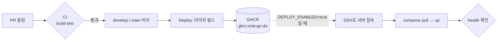
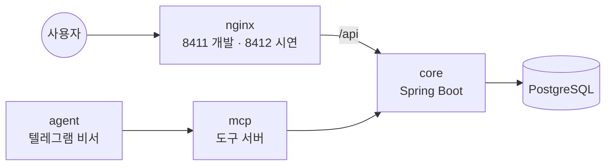

# infra

M-SPACE 서버 실행 설정 (담당: 재웅). 앱 코드는 각 저장소(mspace-core, mspace-web …)에 있고, 여기는 **서버에서 어떻게 띄우는지**만 둔다.

| 파일 | 하는 일 |
|---|---|
| `compose.yaml` | 입구 nginx → core → PostgreSQL, AI 비서(mcp·agent)는 안쪽에서만. 밖으로 열리는 포트는 nginx 하나 |
| `nginx/default.conf` | `/api` → core, 나머지 → 화면(web, 준비 중) |
| `scripts/backup.sh` | DB를 `backups/dev/`·`backups/prod/`에 날짜별로 백업, 7일 지난 건 삭제. 서버 cron으로 매일 실행 |
| `.env.example` | 환경별 값 목록 (값은 비움). 실제 값은 `.env.dev` / `.env.prod`, 커밋 금지 |

## 전체 흐름

코드가 서버에 올라가기까지. 팀원은 PR만 올리면 되고, 나머지는 자동으로 돈다.



| 언제 | 무엇이 | 결과 |
|---|---|---|
| PR 올릴 때 | `ci.yml` (빌드·테스트, 레포마다 Sonar) | 실패하면 머지 버튼 막힘 |
| develop·main에 머지될 때 | `deploy.yml`의 `image` job | 이미지 태그 `develop`/`main` + `sha-xxxxxxx` |
| 그 다음 (서버 준비 후 켬) | `deploy.yml`의 `server` job | develop → 개발 서버(8411), main → 시연 서버(8412) |

서버 안에서는 이렇게 연결된다. 밖에서 들어오는 문은 nginx 하나뿐이다.



## 띄우기

```bash
cp .env.example .env.dev        # DB_PASSWORD 채우기
docker compose -p mspace-dev  --env-file .env.dev  up -d    # 개발 (8411, develop 이미지)
docker compose -p mspace-prod --env-file .env.prod up -d    # 시연 (8412, main 이미지)
curl localhost:8411/actuator/health
```

## 되돌리기

`.env.*`의 `CORE_TAG`(비서는 `ASSISTANT_TAG`)를 이전 이미지(`sha-xxxxxxx`)로 바꾸고 `docker compose ... up -d`.

## 백업

```bash
scripts/backup.sh prod                     # 지금 바로 한 번
crontab -e                                 # 매일 새벽 4시 자동
0 4 * * * cd ~/infra && mkdir -p backups && scripts/backup.sh prod >> backups/backup.log 2>&1
```

백업 파일은 나만 읽을 수 있게(700/600) 만든다. 학번·이메일이 들어 있다.

### 복구

```bash
scripts/restore.sh prod backups/prod/파일.sql.gz
```

복구하면 지금 DB가 **백업 시점으로 통째로 바뀐다**. 스크립트는 먼저 빈 새 DB에 백업을 넣어 보고(SQL 오류가 하나라도 나면 멈추고 지금 DB는 그대로), 성공하면 core·mcp·agent를 잠깐 멈춘 뒤 DB 이름만 바꿔 끼운다. 옛 DB는 `<DB이름>_before_<시각>`으로 남으니 확인한 뒤 지운다. 확인을 위해 `prod`를 한 번 더 입력해야 한다.
