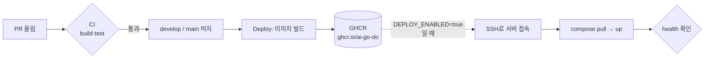
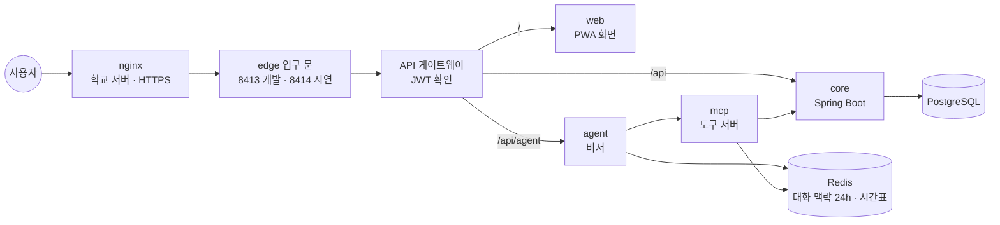
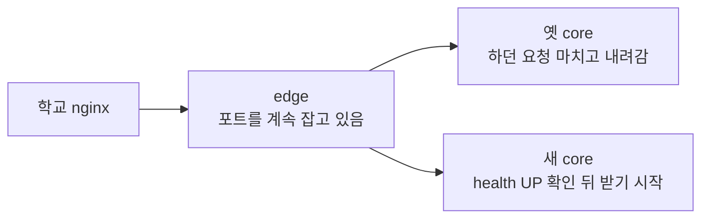

# infra

M-SPACE 서버 실행 설정 (담당: 재웅). 앱 코드는 각 저장소(mspace-core, mspace-web …)에 있고, 여기는 **서버에서 어떻게 띄우는지**만 둔다.

| 파일 | 하는 일 |
|---|---|
| `compose.yaml` | 입구 문(edge) → API 게이트웨이(mspace-gateway) → 화면(web)·core·agent, core → PostgreSQL, MCP·Redis(비서 대화 맥락)는 안쪽에서만. 밖으로 열리는 포트는 edge 하나 |
| `edge/default.conf` | 입구 문 nginx 설정. 교체 중인 컨테이너를 피해 살아 있는 쪽으로 보낸다 (아래 "무중단 배포") |
| `scripts/rollout.sh` | 무중단 교체: 새 컨테이너를 옆에 띄워 확인 → 옛 것을 끈다. 각 레포 `deploy.yml`이 부른다 |
| `.github/workflows/rollout.yml` | 서버 터미널 없이 무중단 교체를 손으로 돌린다 (Actions → "무중단 교체" → Run workflow) |
| `scripts/backup.sh` | DB를 `backups/dev/`·`backups/prod/`에 날짜별로 백업, 7일 지난 건 삭제. 서버 cron으로 매일 실행 |
| `.env.example` | 환경별 값 목록 (값은 비움). 실제 값은 `.env.dev` / `.env.prod`, 커밋 금지 |

## 전체 흐름

코드가 서버에 올라가기까지. 팀원은 PR만 올리면 되고, 나머지는 자동으로 돈다.



| 언제 | 무엇이 | 결과 |
|---|---|---|
| PR 올릴 때 | `ci.yml` (빌드·테스트, 레포마다 Sonar) | 실패하면 머지 버튼 막힘 |
| develop·main에 머지될 때 | `deploy.yml`의 `image` job | 이미지 태그 `develop`/`main` + `sha-xxxxxxx` |
| 그 다음 (서버 준비 후 켬) | `deploy.yml`의 `server` job | develop → 개발 서버(8413), main → 시연 서버(8414) |

서버 안에서는 이렇게 연결된다. 앞의 nginx(학교 서버, HTTPS)를 지나면 들어오는 문은 게이트웨이 하나뿐이다.



- Redis에는 비서 대화 맥락(학생별 24시간 TTL)과 시간표(TTL 없음)를 둔다. AOF(`appendonly yes`) + `redis-data` 볼륨이라 컨테이너를 다시 만들어도 남는다. 예약 데이터는 PostgreSQL에만 있다. 메모리 64MB가 차면 TTL 있는 대화 키만 지우고 시간표는 지우지 않는다. 시간표는 `scripts/backup.sh` 대상이 아니다(학생이 다시 넣을 수 있는 데이터)

## 띄우기

```bash
cp .env.example .env.dev        # DB_PASSWORD 채우기
openssl rand -hex 32            # 장치 토큰. 개발·시연용을 따로 만들어 .env.dev / .env.prod의 MSPACE_DEVICE_TOKEN에 넣는다. 비어 있으면 compose가 멈춘다
# 같은 값을 그 서버를 부르는 키패드(게이트웨이) 장치의 .env에도 넣는다. 다르면 장치 요청이 401
openssl rand -base64 48         # 로그인 토큰 서명값. 개발·시연용을 따로 만들어 JWT_SECRET에 넣는다. 비어 있으면 compose가 멈춘다
openssl rand -hex 32            # 비서 Redis 비밀번호. 개발·시연용을 따로 만들어 REDIS_PASSWORD에 넣는다. 비어 있으면 compose가 멈춘다 (영문·숫자만, URL에 들어간다)
# 이미 .env.dev/.env.prod가 있으면 WEB_TAG·GATEWAY_TAG 줄을 추가 (개발 develop, 시연 main). 없으면 compose가 멈추고 알려 준다
docker compose -p mspace-dev  --env-file .env.dev  up -d    # 개발 (8413, develop 이미지)
docker compose -p mspace-prod --env-file .env.prod up -d    # 시연 (8414, main 이미지)
curl localhost:8413/actuator/health      # 개발, 맥. 학교 서버는 curl 10.116.64.12:8413/actuator/health
curl localhost:8414/actuator/health      # 시연, 맥. 학교 서버는 curl 10.116.64.12:8414/actuator/health
```

화면 이미지(`mspace-web`)는 mspace-web 레포의 `deploy.yml`이 develop·main에 머지될 때 GHCR에 올린다. 아직 그 태그가 GHCR에 없으면 `up`이 web을 받지 못해 멈추니, 그동안은 같은 이름으로 직접 빌드해 쓴다(compose는 로컬에 있는 이미지를 먼저 쓴다).

```bash
docker build -t ghcr.io/ai-go-do/mspace-web:develop ../mspace-web   # mspace-web 클론 위치
```

## 게이트웨이 포트와 설정 반영

- 서버 포트는 gateway가 아니라 입구 문 **edge**가 잡는다(무중단 배포 때문). edge는 기본 `127.0.0.1:${PORT}`(이 컴퓨터 안)에서만 받는다. 학교 서버에서는 Nginx 관리자가 `http://10.116.64.12:<포트>`로 부르므로 `.env.dev`·`.env.prod`에 `BIND_ADDR=10.116.64.12`를 넣는다. `0.0.0.0`은 쓰지 않는다(Docker가 연 포트는 ufw를 건너뛴다). 서버에서 `ss -tln | grep 841`이 `10.116.64.12:8413`으로 나오면 맞다.
- 맥에서 같은 와이파이의 폰·키패드 노트북으로 시험할 때만 `.env.dev`에 `BIND_ADDR=0.0.0.0`. 서버에서는 넣지 않는다.
- 길(어느 주소를 어디로)과 로그인 없이 여는 API 목록은 **mspace-gateway 레포**에 있다(`application.yml`, `PublicPaths.java`). 바꾸려면 그 레포에 PR → 머지되면 이미지가 새로 나오고 배포 때 바뀐다.
- `JWT_SECRET`은 core와 게이트웨이가 같은 값을 쓴다(같은 `.env`에서 넘김). 다르면 로그인한 요청이 전부 401.
- 게이트웨이 이미지를 바로 바꾸려면 서버에서 (끊김 없이):

```bash
T=dev   # 시연 서버는 T=prod
C="docker compose -p mspace-$T --env-file .env.$T"
git pull --ff-only && $C config -q && $C pull gateway && scripts/rollout.sh $T gateway
```

## 무중단 배포

배포할 때 화면·API가 끊기지 않게 한다. 학교 nginx는 그대로 두고 compose 안에서만 해결한다.



| 단계 | `scripts/rollout.sh dev core` 가 하는 일 |
|---|---|
| 1 | 이미지·설정이 그대로면 건너뛴다 (compose `config --hash`와 이미지 ID 비교) |
| 2 | 옛 컨테이너는 둔 채 새 컨테이너를 하나 더 띄운다 (`--scale core=2 --no-recreate`) |
| 3 | 새 컨테이너 health를 edge 안에서 직접 부른다 (core 최대 180초). **실패하면 새 것만 지우고 멈춘다 → 옛 것이 계속 서비스** |
| 4 | 5초 기다린 뒤(edge가 새 컨테이너를 찾을 시간) 옛 것을 SIGTERM으로 끈다. Spring Boot·nginx가 하던 요청을 마치고 내려간다 |

- **edge**(`nginx:1.28-alpine`, 메모리 수 MB)가 서버 포트를 계속 잡고, 뒤 서비스 이름을 2초마다 다시 찾는다(`resolve`). 꺼지는 컨테이너에 연결이 안 되면 다른 컨테이너로 다시 보낸다(`proxy_next_upstream`, POST는 아직 안 보냈을 때만)
- gateway·mcp·agent가 core를 부를 때도 edge(`edge:8080`)를 지난다. 그래서 core가 바뀌는 동안 안쪽 호출도 안 끊긴다
- 무중단 대상: **core, gateway, web**. mcp·agent는 확인 토큰·채팅 작업을 메모리에 들고 있어 두 개를 같이 띄우면 섞인다 → 지금처럼 다시 만든다(비서만 잠깐 끊김). Redis로 옮기면 같이 무중단 가능 (비서 담당과 상의)
- `edge/default.conf`만 바꾸면 edge를 다시 만들지 않고 `nginx -s reload`로 반영한다(rollout.sh가 매번 문법 확인 후 reload)
- 처음 한 번은 서버 포트를 옛 gateway에서 edge로 옮긴다. 새 gateway를 먼저 띄워 확인 → 옛 gateway 끄기 → edge 시작이라 끊김은 몇 초
- 서버 터미널에 들어갈 수 없으면 GitHub Actions의 **"무중단 교체"** 워크플로(main에서 Run workflow)로 같은 일을 한다. 환경(prod/dev)·서비스(`core gateway web`)·재시작 여부를 고르면 앱 배포와 같은 Secrets로 서버에 들어가 `git pull` → `scripts/rollout.sh`를 돌리고 입구 health까지 확인한다

**팀이 지켜야 할 것**

- **DB 마이그레이션은 "추가만" 먼저.** 교체하는 동안 옛 core와 새 core가 같은 DB를 잠깐 같이 쓴다. 컬럼 이름 바꾸기·지우기는 한 번에 하지 말고 ① 새 컬럼 추가 배포 → ② 다음 배포에서 옛 컬럼 삭제
- 스케줄러(자동 퇴실·노쇼·알림)가 몇 초 동안 두 core에서 같이 돈다. 지금 코드는 `ON CONFLICT DO NOTHING`·상태 조건으로 한 번만 처리돼서 괜찮다. 새 스케줄러를 만들 때도 두 번 돌아도 같은 결과가 나오게
- 교체하는 동안 core JVM이 잠깐 두 개라 메모리를 더 쓴다. 배포는 서버에서 한 번에 하나씩만 돈다(flock)

**시험 결과 (11/6, 가짜 서비스로)**: 옛 배치(gateway가 포트를 잡던 상태)에서 edge로 옮기기 → 끊김 약 2초(처음 한 번). 그 뒤 core·gateway·web 교체 중 0.1초마다 보낸 GET·POST·화면 요청 1,401건·690건 모두 200. 새 core가 켜지자마자 죽게 만들면 rollout이 실패로 끝나고 옛 core가 계속 응답(285건 모두 200). 실제 서버 시험은 확인 필요.

## 되돌리기

`.env.*`의 `CORE_TAG`(화면은 `WEB_TAG`, 비서는 `ASSISTANT_TAG`, 게이트웨이는 `GATEWAY_TAG`, 방 공기는 `CLIMATE_TAG`)를 이전 이미지(`sha-xxxxxxx`)로 바꾸고, compose 설정을 먼저 확인한 뒤 다시 켠다.

```bash
T=dev   # 시연 서버는 T=prod
C="docker compose -p mspace-$T --env-file .env.$T"
$C config -q && scripts/rollout.sh $T core web gateway   # 끊김 없이. 비서는 $C up -d --no-deps mcp agent
$C up -d --no-deps climate                               # 방 공기는 rollout.sh 대상이 아니라 따로 다시 켠다
```

## 백업

```bash
scripts/backup.sh prod                     # 지금 바로 한 번
crontab -e                                 # 매일 새벽 4시 자동
0 4 * * * cd ~/infra && mkdir -p backups && scripts/backup.sh prod >> backups/backup.log 2>&1
```

백업 파일은 나만 읽을 수 있게(700/600) 만든다. 학번·이메일이 들어 있다.

### 복구

```bash
scripts/restore.sh prod backups/prod/파일.sql.gz
```

복구하면 지금 DB가 **백업 시점으로 통째로 바뀐다**. 스크립트는 먼저 빈 새 DB에 백업을 넣어 보고(SQL 오류가 하나라도 나면 멈추고 지금 DB는 그대로), 성공하면 core·mcp·agent를 잠깐 멈춘 뒤 DB 이름만 바꿔 끼운다. 옛 DB는 `<DB이름>_before_<시각>`으로 남으니 확인한 뒤 지운다. 확인을 위해 `prod`를 한 번 더 입력해야 한다.
